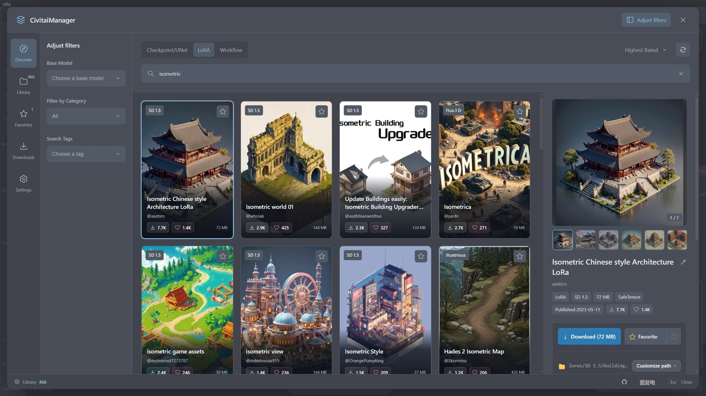
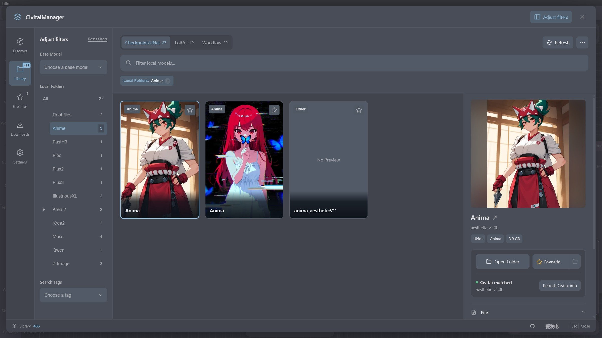
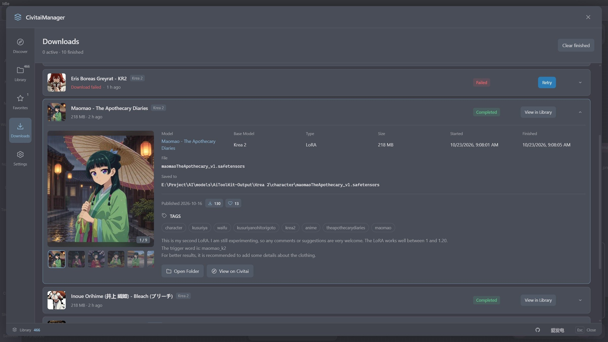
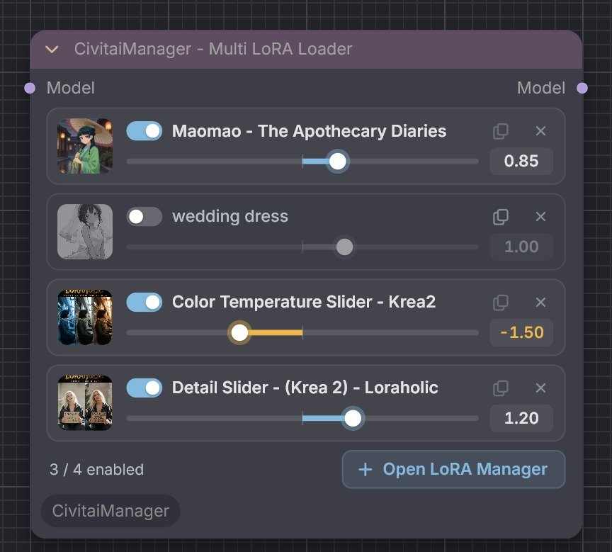
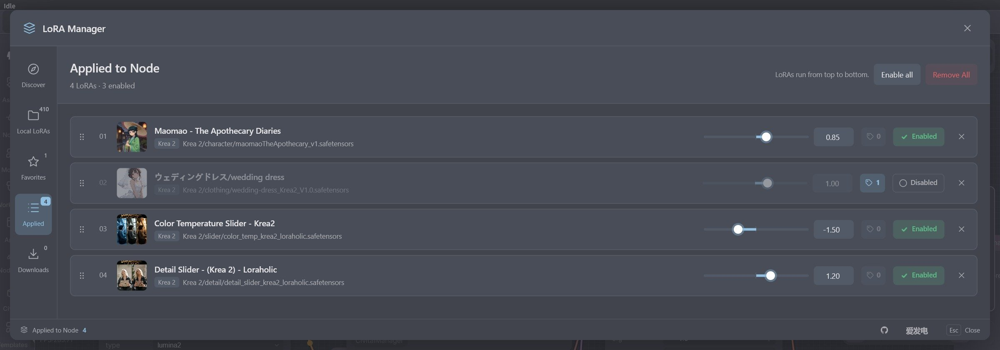
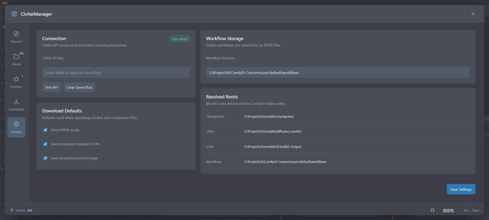

<div align="center">

**English** · [简体中文](./README.zh-CN.md)

# CivitaiManager

### Find, download, organize, and use Civitai models without leaving ComfyUI

[](https://github.com/nregret/CivitaiManager)
[](https://registry.comfy.org/publishers/nnegret/nodes/CivitaiManager)
[](https://www.python.org/)
[](https://github.com/comfyanonymous/ComfyUI)
[](https://github.com/nregret/CivitaiManager)

**CivitaiManager** is a ComfyUI extension for managing Civitai resources.<br>
Search, download, and organize **Checkpoints, UNets, LoRAs, and Workflows** right inside the workflow editor, then put them to work with the built-in multi-LoRA loader node.

[Features](#features) · [Installation](#installation) · [API Key](#civitai-api-key) · [Quick Start](#quick-start) · [FAQ](#faq) · [Support](#support-the-project)

</div>

<p align="center">
  
</p>

> From "found a model" to "it's in my workflow" in as few steps as possible: online discovery, your local library, favorites, downloads, and the multi-LoRA node all work as one connected flow.

## Features

### Discover: search, filter, and download

Browse Civitai from inside ComfyUI. Cards on the left let you scan results quickly; the detail panel on the right shows versions, files, preview images, and trigger words. When you're ready, the model is queued for download into an automatically planned folder.

- Covers Checkpoint / UNet, LoRA, and Workflow, with search-as-you-type. Combine base model, category, tag, and sort filters; click a tag in the detail panel to filter by it.
- Images load as they approach the viewport and fade in where they land. When a search yields only a few results, the manager keeps looking in the background and shows a progress bar above the cards instead of empty placeholders.
- The detail panel has a multi-image gallery (with a full-size viewer inside the manager), version and file pickers, plus type, base model, size, format, and publish date. Click a trigger word to copy it.
- Early Access versions, which must be unlocked with Buzz first, get a lock badge on their card and a notice in the detail panel with a link to unlock them on Civitai.
- Before downloading, you can confirm or change the planned folder and file name.
- Browse cards with the arrow keys. In narrow windows the detail panel opens as a slide-in drawer; press `Esc` to close it.

### Library: keep your model folders under control

CivitaiManager reads every model root that ComfyUI has configured and brings models scattered across folders and subfolders into a single view.

<p align="center">
  
</p>

- A folder tree shows where your models live and how many each folder holds. Filter by resource type, base model, folder, and tag.
- View previews, metadata, trigger words, and the Civitai match status, and open the containing folder in one click.
- Move, rename, favorite, and delete models; companion metadata JSON and preview images are updated along with them.
- Models without Civitai information can be matched automatically by SHA256.

### Downloads: progress, failure reasons, and details

<p align="center">
  
</p>

- Downloads run in the background, up to 3 at a time, with progress, speed, and time remaining. Closing the manager does not stop them.
- Task records are stored in your user directory, and finished ones are kept for 24 hours (up to 100). Tasks interrupted by a ComfyUI restart are marked as failed and can be retried in one click.
- Failures are grouped by cause: Early Access, API key rejected, access denied, file no longer available, too many requests, Civitai unavailable, network error, and could not save the file. Each comes with a suggested next step and Civitai's original message.
- Click a record to expand it (one at a time). You'll see a preview gallery, model and version, file, save location, and timestamps, plus download and like counts, trigger words, tags, and the description fetched from Civitai. Completed records can open their folder directly.

### Multi LoRA Loader and the LoRA Manager

`CivitaiManager - Multi LoRA Loader` holds multiple LoRAs in one node and applies them in list order.

<p align="center">
  
</p>

- Each LoRA gets one row: thumbnail, on/off switch, name, copy trigger words, remove, plus a strength slider and number field (negative strengths are supported). Changes can be undone.
- Click **Open LoRA Manager** on the node to switch between five pages: Discover, Local LoRAs, Favorites, Applied, and Downloads.
- Discover offers **Download and Apply**: when the download finishes, the LoRA is added to the current node with its preview image.

<p align="center">
  
</p>

- The **Applied** page manages the node's LoRAs as a list. Reorder them by dragging the handle or with the arrow keys, enable or disable them with a button, and adjust strength in place. While you drag, the strength is only previewed; it is written when you let go, so it creates a single undo step. Double-click the slider to reset it to 1.00.
- Removing a LoRA can be undone from the toast. LoRAs whose local file is missing are flagged, and clicking a name jumps to it on the Local LoRAs page.

### Favorites

Favorite remote models without downloading them, and sort them into your own folders. When you later download a favorited model, it is merged with the existing favorite by its Civitai model ID.

### Settings and theme

<p align="center">
  
</p>

- Save and test your Civitai API key, choose whether NSFW content is shown, and whether metadata JSON and preview images are saved.
- Set the folder for downloaded workflows and see which folders Checkpoints, UNets, LoRAs, and Workflows actually resolve to.
- The interface colors follow your current ComfyUI palette: light, dark, or custom.

## Installation

<details>
<summary><strong>Show installation steps</strong></summary>

<br>

### Option 1: ComfyUI Manager (recommended)

1. Open ComfyUI Manager.
2. Search for `CivitaiManager`.
3. Click **Install**.
4. Restart ComfyUI.

You can also see the published versions on [the Comfy Registry](https://registry.comfy.org/publishers/nnegret/nodes/CivitaiManager).

### Option 2: Comfy CLI

```bash
comfy node install CivitaiManager
```

Then restart ComfyUI.

### Option 3: Git clone

From ComfyUI's `custom_nodes` folder, run:

```bash
git clone https://github.com/nregret/CivitaiManager.git
```

Then restart ComfyUI. There are no extra dependencies, so no `pip install` is needed.

</details>

## Civitai API Key

Browsing public content works without a key, but adding one is recommended:

- Some models can only be downloaded by signed-in users. Without a valid key, those downloads fail with **API Key rejected**.
- Search results match your account's permissions and content settings.

To add your key:

1. Sign in to Civitai and open [Account → Security & Apps → API keys](https://civitai.red/user/account/security#api-keys).
2. Click **Add API key**, give it a name such as `ComfyUI`, and copy the generated key.
3. In ComfyUI, open CivitaiManager → **Settings**, paste the key into **Civitai API Key**, and click **Test API**.
4. Click **Save Settings**. The Connection card shows **Key saved** when it's done.

> The key is stored in plain text in `civitai_manager/config.json` inside ComfyUI's user directory, so don't share that file. It is sent only to Civitai (and dropped when a download redirects to another host), and the settings page never shows it again. Saving with the field empty keeps the stored key; **Clear Saved Key** removes it.

## Quick Start

1. After restarting ComfyUI, click the **Civitai** icon in the left sidebar; the manager opens directly. Older frontends show a floating launcher button instead.
2. On first use, open **Settings**, add your [Civitai API key](#civitai-api-key), and check the model and workflow folders.
3. In **Discover**, pick a resource type and search. Click a card to see its versions, files, and previews.
4. Confirm the save location and click download, then follow the progress in **Downloads**.
5. Manage downloaded models in the **Library**, or add the `CivitaiManager - Multi LoRA Loader` node to your workflow.

## Using the Multi LoRA Loader

Add it from the `CivitaiManager/Loaders` category of the node menu:

```text
CivitaiManager - Multi LoRA Loader
```

Connect it like this:

```text
MODEL → CivitaiManager - Multi LoRA Loader → MODEL
```

LoRA paths, strengths, switches, and order are saved in the workflow, and existing workflows load as-is. The node's controls are built on ComfyUI's native DOMWidget, and changing a strength or switch keeps any size you set by hand. A LoRA whose file cannot be found is skipped with a message in the terminal, so the rest of the list still loads.

## FAQ

<details>
<summary><strong>Show FAQ</strong></summary>

<br>

### A download failed with "API Key rejected". What now?

Civitai did not accept the key: it may be mistyped, deleted, or no longer valid. Create a new one under [API keys](https://civitai.red/user/account/security#api-keys), paste it in **Settings**, click **Test API** and **Save Settings**, then click **Retry** on the failed download.

### A download failed with "Early Access". What now?

The creator released this version as Early Access, so it must be unlocked with Buzz on the Civitai website first. Until then Civitai refuses the download no matter which API key you use. Expand the failed record, click **Unlock on Civitai**, and once it's unlocked, click **Retry** in Downloads.

### Why does a local model have no preview or Civitai information?

Select the model in the **Library** and click **Match Civitai info**, or choose **Match missing Civitai info** from the menu in the top-right corner to match many at once. The manager computes the file's SHA256 and looks up the matching file on Civitai.

### Where are downloaded files saved?

Checkpoints, UNets, and LoRAs go to ComfyUI's folder for that model type; workflows go to the folder set in Settings. The actual paths are listed on the right side of the Settings page, and you can change the folder and file name in the detail panel before downloading.

### Can it manage multiple model roots?

Yes. The Library reads every root that ComfyUI has configured for each resource type and remembers which root each model lives in.

### Why are "base model + keyword" searches slower?

Civitai can't search by keyword within a specific base model, so the manager pages through that base model's catalog and filters by keyword itself. Results appear as they are found, a progress bar runs above the cards, and the search stops once the scan is done.

### Which Civitai site does the manager use?

Search, model details, and downloads all go through `civitai.red`. Older download records that point to `civitai.com` are converted automatically.

### Why doesn't cancelling a download take effect immediately?

Cancellation is checked between network reads. If a request is waiting on the network, it takes effect once that read completes or times out.

</details>

## Feedback and Contributing

Please report bugs, ideas, and compatibility issues on [GitHub Issues](https://github.com/nregret/CivitaiManager/issues). It helps to include:

- Your ComfyUI and frontend versions
- Your operating system and Python version
- Steps to reproduce
- Related errors from the browser console or the ComfyUI terminal

<details>
<summary><strong>Project layout and checks</strong></summary>

```text
CivitaiManager/
├── __init__.py                 # ComfyUI entry point and web directory
├── nodes.py                    # API registration and the Multi LoRA Loader node
├── manager_api.py              # Backend orchestration and API handlers
├── backend/
│   ├── client.py               # Civitai requests (gzip, keep-alive, host checks)
│   ├── config.py               # Config loading and validation
│   ├── downloads.py            # Persistent download jobs
│   ├── library.py              # Local model index cache
│   └── routes.py               # HTTP route table
├── js/
│   ├── civitai_manager.js      # Main manager
│   ├── civitai_lora_node.js    # Multi LoRA node and LoRA Manager
│   └── civitai/                # Modules shared by both managers
│       ├── api.js              # API calls plus search and detail caches
│       ├── card_media.js       # Card image lazy loading and skeletons
│       ├── detail.js           # Detail gallery, tags, Early Access notice
│       ├── downloads.js        # Download list and expandable details
│       ├── selector_ui.js      # Shared controls
│       ├── selector_styles.js  # Styles and theme colors
│       └── ...                 # State, favorites, i18n, node widgets, and more
├── locales/{en,zh}/            # ComfyUI locale resources
├── img/{en,zh}/                # README screenshots (English / Chinese UI)
├── tests/                      # Backend and node regression tests
└── pyproject.toml              # Comfy Registry metadata
```

Run the checks:

```powershell
python -m unittest discover -s tests -v
node tests/test_lora_widgets.mjs
Get-ChildItem js -Recurse -Filter *.js | ForEach-Object { node --check $_.FullName }
```

Tests use temporary folders and ComfyUI stand-ins; they never touch the network or your real model folders.

</details>

## Support the Project

If CivitaiManager saves you time organizing models and building workflows, a **Star** on GitHub is much appreciated, or you can buy the author a coffee on Afdian. Your support goes toward ongoing maintenance, keeping up with new ComfyUI releases, and more useful features.

<p align="center">
  <a href="https://www.ifdian.net/a/nnegret?utm_source=copylink&utm_medium=link">
    
  </a>
</p>

<p align="center">
  Thanks to everyone who uses, reports issues for, and supports CivitaiManager ☕
</p>
