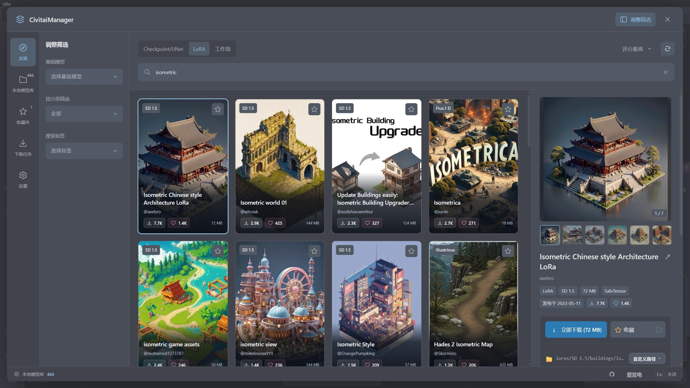
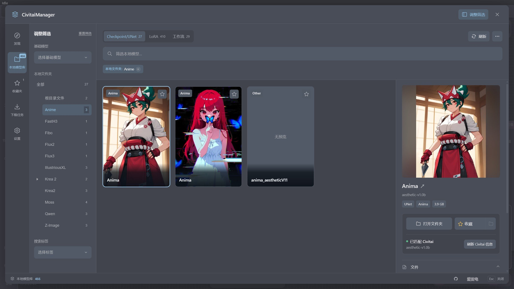
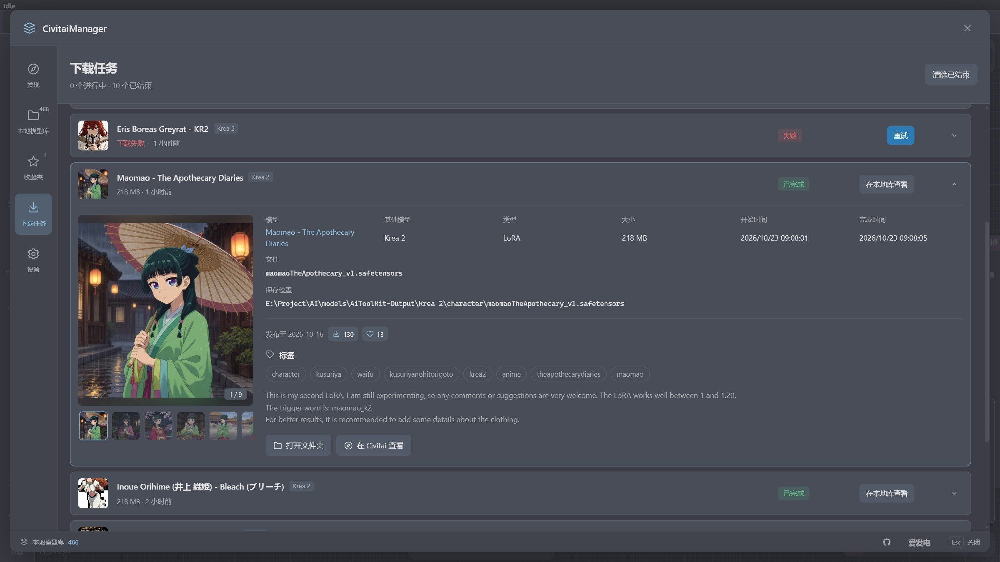
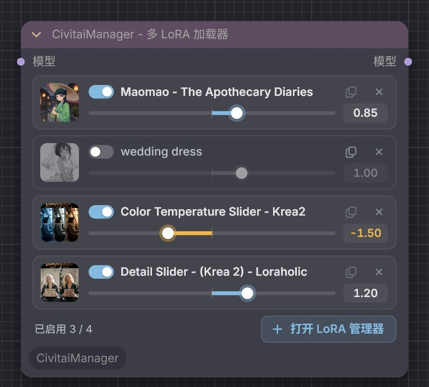
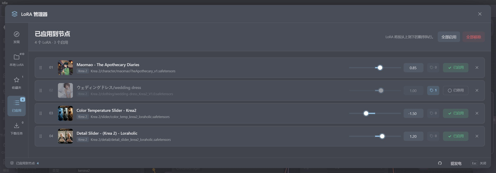
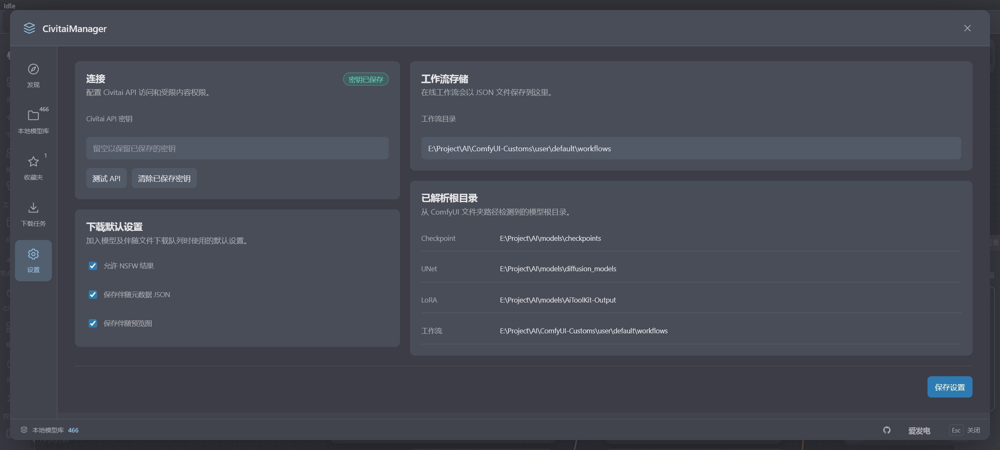

<div align="center">

[English](./README.md) · **简体中文**

# CivitaiManager

### 在 ComfyUI 内完成 Civitai 模型的发现、下载、整理与使用

[](https://github.com/nregret/CivitaiManager)
[](https://registry.comfy.org/zh/publishers/nnegret/nodes/CivitaiManager)
[](https://www.python.org/)
[](https://github.com/comfyanonymous/ComfyUI)
[](https://github.com/nregret/CivitaiManager)

**CivitaiManager** 是一个面向 ComfyUI 的 Civitai 资源管理扩展。<br>
不离开工作流界面，就能搜索、下载和整理 **Checkpoint、UNet、LoRA 与 Workflow**，再通过多 LoRA 加载节点直接用进工作流。

[功能](#功能) · [安装](#安装) · [快速开始](#快速开始) · [常见问题](#常见问题) · [支持项目](#支持项目)

</div>

<p align="center">
  
</p>

> 从“找到模型”到“放进工作流”，尽量只做一次选择：在线发现、本地模型库、收藏夹、下载任务和多 LoRA 节点连成一条完整的链路。

## 功能

### 发现：搜索、筛选与下载

在 ComfyUI 里直接浏览 Civitai。左侧是卡片列表，右侧详情用来确认版本、文件、预览图和触发词，确认后按自动规划的目录加入下载队列。

- 覆盖 Checkpoint / UNet、LoRA 与 Workflow，边输入边搜索；可按基础模型、分类、标签和排序组合筛选，详情里的标签点一下即可作为筛选条件。
- 图片在接近可视区域时才开始加载，加载完成后在原位淡入；结果较少时会在后台继续查找，卡片区顶部显示进度条，不会出现空的占位卡片。
- 详情面板提供多图画廊（可在管理器内查看大图）、版本与文件选择，以及类型、基础模型、大小、格式和发布日期；触发词点击即可复制。
- 需要用 Buzz 解锁的抢先体验（Early Access）版本，会在卡片上显示锁形标记，详情中也会提示并提供前往 Civitai 解锁的入口。
- 下载前可以确认或修改自动规划的保存目录和文件名。
- 支持方向键浏览卡片；窗口较窄时详情以侧滑抽屉显示，按 `Esc` 收起。

### 本地模型库：把模型目录管起来

读取 ComfyUI 为各类模型配置的全部根目录，把分散在不同目录和子文件夹里的模型整理成一个视图。

<p align="center">
  
</p>

- 用文件夹树展示模型分布和数量，可按资源类型、基础模型、目录和标签筛选。
- 查看预览图、元数据、触发词以及与 Civitai 的匹配状态，可一键打开所在文件夹。
- 支持移动、重命名、收藏和删除，同时更新配套的元数据 JSON 和预览图。
- 缺少 Civitai 信息的模型，可以通过 SHA256 自动匹配补全。

### 下载任务：进度、失败原因与详情

<p align="center">
  
</p>

- 下载在后台进行（最多 3 个同时下载），显示进度、速度和剩余时间；关闭管理器不影响下载。
- 任务记录保存在用户目录中，已结束的记录保留 24 小时（最多 100 条）。ComfyUI 重启时被打断的任务会标记为失败，可一键重试。
- 失败会按原因区分：抢先体验、API Key 无效、没有下载权限、文件已不存在、请求过于频繁、Civitai 暂时不可用、网络错误、文件保存失败，并给出对应的处理建议和 Civitai 返回的原始信息。
- 点击一条记录即可展开（同一时间只展开一条），内容包括预览画廊、模型与版本、文件、保存位置和时间，以及从 Civitai 获取的下载量、点赞数、触发词、标签和简介；已完成的记录可以直接打开所在文件夹。

### Multi LoRA Loader 与 LoRA 管理器

`CivitaiManager - Multi LoRA Loader` 用一个节点收纳多个 LoRA，按列表顺序依次应用。

<p align="center">
  
</p>

- 每个 LoRA 一行：缩略图、开关、名称、复制触发词、移除，以及强度滑条和数值框（支持负数强度）。修改可以撤销。
- 点击节点上的 **打开 LoRA 管理器**，可在发现、本地 LoRA、收藏、已应用和下载任务五个页面之间切换。
- 发现页支持 **下载并应用**：下载完成后自动加入当前节点，并显示预览图。

<p align="center">
  
</p>

- **已应用** 页以列表管理节点中的 LoRA：拖动手柄或用方向键调整顺序，用按钮启用或停用，直接调整强度（拖动时只预览，松手后才写入，只产生一条撤销记录；双击滑条恢复为 1.00）。
- 移除后可以在提示条中撤销；本地文件缺失的 LoRA 会被标出，点击名称可跳到本地 LoRA 页并选中它。

### 收藏夹

远程模型无需下载就能收藏，并可整理到自定义收藏夹中。之后下载到本地时，会按 Civitai 模型 ID 自动和原收藏合并为同一条记录。

### 设置与主题

<p align="center">
  
</p>

- 保存并测试 Civitai API Key，设置是否显示 NSFW 内容，以及是否保存元数据 JSON 和预览图。
- 指定工作流的保存目录，并查看 Checkpoint、UNet、LoRA 和工作流实际使用的目录。
- 界面配色会跟随 ComfyUI 当前的调色板（浅色、深色或自定义调色板）。

## 安装

<details>
<summary><strong>展开安装说明</strong></summary>

<br>

### 方法一：ComfyUI Manager（推荐）

1. 打开 ComfyUI Manager。
2. 搜索 `CivitaiManager`。
3. 点击 **Install**。
4. 安装完成后重启 ComfyUI。

也可以访问 [Comfy Registry 中的 CivitaiManager](https://registry.comfy.org/zh/publishers/nnegret/nodes/CivitaiManager) 查看已发布的版本。

### 方法二：Comfy CLI

```bash
comfy node install CivitaiManager
```

安装完成后重启 ComfyUI。

### 方法三：Git 克隆

在 ComfyUI 的 `custom_nodes` 目录中执行：

```bash
git clone https://github.com/nregret/CivitaiManager.git
```

然后重启 ComfyUI。项目没有额外依赖，不需要执行 `pip install`。

</details>

## 快速开始

1. 重启 ComfyUI 后，点击左侧边栏的 **Civitai** 图标，管理器会直接打开。旧版前端会改为显示一个悬浮入口。
2. 第一次使用时建议先进入 **设置**，填写 Civitai API Key，并确认模型和工作流的保存目录。
3. 在 **发现** 中选择资源类型并搜索，点击卡片查看版本、文件和预览图。
4. 确认保存路径后点击下载，在 **下载任务** 中查看进度。
5. 在 **本地模型库** 中管理已下载的模型，或在工作流中添加 `CivitaiManager - Multi LoRA Loader` 节点。

> 浏览公开内容不一定需要 API Key，但建议配置：下载部分模型需要登录，而且搜索结果会与你账号的权限保持一致。

## Multi LoRA Loader 使用方式

在节点菜单的 `CivitaiManager/Loaders` 分类中添加：

```text
CivitaiManager - Multi LoRA Loader
```

连接方式：

```text
MODEL → CivitaiManager - Multi LoRA Loader → MODEL
```

LoRA 的路径、强度、开关和顺序都保存在工作流中，旧工作流可以直接载入。节点控件基于 ComfyUI 原生的 DOMWidget，修改强度或开关时会保留你手动调整过的节点尺寸。找不到文件的 LoRA 会被跳过并在终端输出日志，不会中断其余 LoRA 的加载。

## 常见问题

<details>
<summary><strong>展开常见问题</strong></summary>

<br>

### 下载失败，提示“抢先体验”怎么办？

这类版本被作者设为抢先体验，需要先在 Civitai 网站上用 Buzz 解锁；解锁之前，无论用哪个 API Key，Civitai 都会拒绝下载。展开失败记录，点击 **前往 Civitai 解锁**，解锁后回到下载任务中点击 **重试** 即可。

### 为什么本地模型没有预览图或 Civitai 信息？

在 **本地模型库** 中选中模型后点击 **匹配 Civitai 信息**，或在右上角的菜单中选择 **匹配缺失的 Civitai 信息** 进行批量匹配。管理器会计算文件的 SHA256，并在 Civitai 上查找对应的文件记录。

### 下载的文件保存在哪里？

Checkpoint、UNet 和 LoRA 保存到 ComfyUI 中对应类型的模型目录，工作流保存到设置页指定的目录，实际路径可以在设置页右侧查看。下载前也可以在详情中修改保存目录和文件名。

### 可以同时管理多个模型根目录吗？

可以。本地模型库会读取 ComfyUI 为每种资源类型配置的全部根目录，并记录每个模型所在的根目录。

### 为什么“基础模型 + 关键词”的搜索比较慢？

Civitai 不支持在指定基础模型的范围内按关键词搜索，管理器只能逐页拉取该基础模型下的模型再按关键词筛选。这时结果会边找边出现，卡片区顶部显示进度条，扫描完毕后自动停止。

### 管理器访问的是哪个 Civitai 站点？

搜索、模型详情和下载统一走 `civitai.red`。旧版本记录中的 `civitai.com` 下载地址会自动转换。

### 为什么取消下载不是立刻生效？

取消会在下一次读取网络数据时生效。如果当前请求正在等待网络响应，需要等这次读取完成或超时。

</details>

## 反馈与贡献

欢迎通过 [GitHub Issues](https://github.com/nregret/CivitaiManager/issues) 提交问题、功能建议和兼容性反馈。反馈时建议附上：

- ComfyUI 与前端版本
- 操作系统和 Python 版本
- 复现步骤
- 浏览器控制台或 ComfyUI 终端中的相关报错

<details>
<summary><strong>项目结构与开发验证</strong></summary>

```text
CivitaiManager/
├── __init__.py                 # ComfyUI 扩展入口与 Web 目录声明
├── nodes.py                    # API 注册与 Multi LoRA Loader 节点
├── manager_api.py              # 后端编排与 API handlers
├── backend/
│   ├── client.py               # Civitai 请求（gzip、连接复用、域名校验）
│   ├── config.py               # 配置读取与校验
│   ├── downloads.py            # 持久化下载任务
│   ├── library.py              # 本地模型索引缓存
│   └── routes.py               # HTTP 路由表
├── js/
│   ├── civitai_manager.js      # 主管理器
│   ├── civitai_lora_node.js    # Multi LoRA 节点与 LoRA 管理器
│   └── civitai/                # 两个弹窗共用的模块
│       ├── api.js              # 接口请求与搜索、详情缓存
│       ├── card_media.js       # 卡片图片懒加载与骨架
│       ├── detail.js           # 详情画廊、标签、抢先体验提示
│       ├── downloads.js        # 下载列表与展开详情
│       ├── selector_ui.js      # 弹窗通用控件
│       ├── selector_styles.js  # 弹窗样式与主题配色
│       └── ...                 # 状态、收藏、国际化、节点控件等
├── locales/{en,zh}/            # ComfyUI locale 资源
├── img/{en,zh}/                # README 截图（英文 / 中文界面）
├── tests/                      # 后端与节点回归测试
└── pyproject.toml              # Comfy Registry 发布元数据
```

运行验证：

```powershell
python -m unittest discover -s tests -v
node tests/test_lora_widgets.mjs
Get-ChildItem js -Recurse -Filter *.js | ForEach-Object { node --check $_.FullName }
```

测试使用临时目录和 ComfyUI 模块替身，不访问网络，也不会修改真实的模型目录。

</details>

## 支持项目

如果 CivitaiManager 帮你省下了整理模型和搭建工作流的时间，欢迎点一个 **Star**，或者在爱发电请作者喝杯咖啡。你的支持会用于持续维护、适配新版 ComfyUI 和开发更多实用功能。

<p align="center">
  <a href="https://www.ifdian.net/a/nnegret?utm_source=copylink&utm_medium=link">
    
  </a>
</p>

<p align="center">
  感谢每一位使用、反馈和支持 CivitaiManager 的朋友 ☕
</p>
